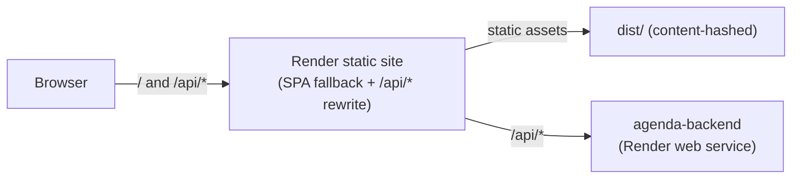

# agenda

[](https://github.com/andreagil5647/agenda/actions/workflows/ci.yml)

Web app for **Agenda**, a calendar and task planner built around time-blocking: tasks and
events live on the same timeline, and you plan a day by dragging tasks into time slots.

The API lives in [andreagil5647/agenda-backend](https://github.com/andreagil5647/agenda-backend).

> **Status:** the day planner works. Sign up or start a one-click demo, then plan a day on
> an hour grid: drag a task onto it to give it time, drag a block to move it, pull its edge
> to resize it, or do all three from the keyboard. Changes show at once and are taken back
> if the API refuses them. A week view, settings and end-to-end tests come next - see the
> [roadmap](docs/ROADMAP.md).

## Stack

| Concern    | Choice                                                      |
| ---------- | ----------------------------------------------------------- |
| Runtime    | React 19, TypeScript 6 (strict)                             |
| Build      | Webpack 5, hand-written dev/prod config, SWC (`swc-loader`) |
| Data       | TanStack Query, API client typed by the OpenAPI contract    |
| Drag       | dnd-kit for pick-up and drop, pointer events for resizing   |
| Styles     | CSS Modules on design tokens, light and dark themes         |
| Validation | zod 4, for build-time `PUBLIC_` environment variables       |
| Tests      | Jest 30 (`@swc/jest`), React Testing Library, MSW           |
| Hosting    | Render static site, rewriting `/api/*` to the backend       |

## Architecture



The browser only ever talks to one origin. In development, `webpack-dev-server` proxies
`/api/*` to a local backend the same way; in production, the static site's rewrite does it
(see [ADR 0003](docs/adr/0003-same-origin-api-through-render-rewrite.md)). This is what
lets a session cookie set by the API stay first-party.

```text
config/webpack/     hand-written webpack config: common, dev, prod, paths, env
src/
  index.tsx            bootstraps React
  app/                 providers, the server and auth gates, the signed-in shell and page
  features/<name>/     api (requests), hooks (state) and components for one feature:
                        auth, calendars, tasks, timeline
  styles/              design tokens and the global base layer
  ui/                  shared primitives: panel, query states, notices, control styles
  lib/api/             API client typed by the contract, one error type, user-facing messages
  lib/time/            time zone conversion and time formatting, pure and unit-tested
  lib/query/           query client and the optimistic write used by every feature
  lib/env.ts           typed access to PUBLIC_ build-time variables
  lib/serverStatus/    polls the API's liveness endpoint with backoff,
                        exposes a "waking up the server" state for free-tier cold starts
openapi/             the API contract, copied from the backend and committed
test/msw/            in-memory API that answers the app's requests during tests
test/setup/          Jest environment and setup
```

## Getting started

Requirements: Node.js 22.13 or later. For the `/api/*` proxy to do anything locally, run
the [backend](https://github.com/andreagil5647/agenda-backend) on port 4000 first.

```bash
pnpm install --frozen-lockfile
cp .env.example .env
pnpm run dev       # http://localhost:3000, proxies /api to http://localhost:4000
```

## Scripts

| Script                                 | What it does                                      |
| -------------------------------------- | ------------------------------------------------- |
| `pnpm run dev`                         | Webpack dev server with HMR and the `/api` proxy  |
| `pnpm run build`                       | Production build to `dist/`                       |
| `pnpm run analyze`                     | Production build plus a bundle-size report        |
| `pnpm test` / `pnpm run test:coverage` | Jest / Jest with a coverage report in `coverage/` |
| `pnpm run lint` / `pnpm run format`    | ESLint (type-aware) / Prettier                    |
| `pnpm run typecheck`                   | `tsc --noEmit`                                    |
| `pnpm run api:sync`                    | Copy the API contract from the backend repo       |
| `pnpm run api:generate` / `api:check`  | Generate the API types / fail if they are stale   |

## Deployment

`render.yaml` describes the service: a free static site, deployed from `main` after CI
passes, that rewrites `/api/*` to the backend before falling back to `index.html` for
client-side routing.

| Variable             | Required | Default | Notes                             |
| -------------------- | -------- | ------- | --------------------------------- |
| `PUBLIC_APP_VERSION` |          | `dev`   | Shown in the footer for debugging |

`PUBLIC_` variables are read at **build** time (baked into the bundle), not at runtime;
changing one on Render requires a redeploy.

## Conventions

- Branches: `main` (deployed) ← `develop` (integration) ← `feat/*`, `fix/*`, `chore/*`,
  `docs/*`. See [CONTRIBUTING.md](CONTRIBUTING.md).
- Commits follow [Conventional Commits](https://www.conventionalcommits.org/), enforced by
  commitlint in a Git hook and in CI.

## Documentation

- [Roadmap](docs/ROADMAP.md): what is built, known gaps and the build order.
- [Architecture decision records](docs/adr/README.md)
- [Debugging notes](docs/debugging/README.md): bugs found during development, with the
  investigation and the regression test that now guards each one.

## License

[MIT](LICENSE)
