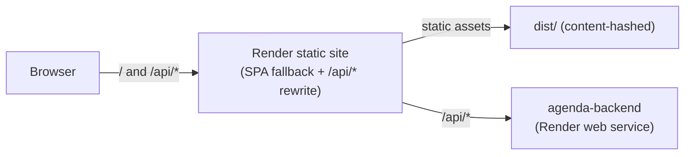

# agenda

[](https://github.com/andreagil5647/agenda/actions/workflows/ci.yml)

Web app for **Agenda**, a calendar and task planner built around time-blocking: tasks and
events live on the same timeline, and you plan a day by dragging tasks into time slots.

The API lives in [andreagil5647/agenda-backend](https://github.com/andreagil5647/agenda-backend).

> **Status:** foundation. Hand-written Webpack 5, TypeScript, linting, testing and CI/CD are
> in place, along with a minimal page that proves the deployment shape end to end (same-origin
> `/api/*`, a cold-start "waking up the server" state). The design system, routing, calendar
> views and the rest of the product come next.

## Stack

| Concern    | Choice                                                      |
| ---------- | ----------------------------------------------------------- |
| Runtime    | React 19, TypeScript 6 (strict)                             |
| Build      | Webpack 5, hand-written dev/prod config, SWC (`swc-loader`) |
| Validation | zod 4, for build-time `PUBLIC_` environment variables       |
| Tests      | Jest 30 (`@swc/jest`), React Testing Library                |
| Hosting    | Render static site, rewriting `/api/*` to the backend       |

## Architecture



The browser only ever talks to one origin. In development, `webpack-dev-server` proxies
`/api/*` to a local backend the same way; in production, the static site's rewrite does it
(see [ADR 0003](docs/adr/0003-same-origin-api-through-render-rewrite.md)). This is what
lets a session cookie set by the API stay first-party.

```text
config/webpack/     hand-written webpack config: common, dev, prod, paths, env
src/
  index.tsx          bootstraps React
  app/App.tsx         current placeholder root
  lib/env.ts           typed access to PUBLIC_ build-time variables
  lib/serverStatus/    polls the API's liveness endpoint with backoff,
                        exposes a "waking up the server" state for free-tier cold starts
test/setup/          Jest setup (jest-dom matchers)
```

## Getting started

Requirements: Node.js 22.13 or later. For the `/api/*` proxy to do anything locally, run
the [backend](https://github.com/andreagil5647/agenda-backend) on port 4000 first.

```bash
npm ci
cp .env.example .env
npm run dev        # http://localhost:3000, proxies /api to http://localhost:4000
```

## Scripts

| Script                               | What it does                                      |
| ------------------------------------ | ------------------------------------------------- |
| `npm run dev`                        | Webpack dev server with HMR and the `/api` proxy  |
| `npm run build`                      | Production build to `dist/`                       |
| `npm run analyze`                    | Production build plus a bundle-size report        |
| `npm test` / `npm run test:coverage` | Jest / Jest with a coverage report in `coverage/` |
| `npm run lint` / `npm run format`    | ESLint (type-aware) / Prettier                    |
| `npm run typecheck`                  | `tsc --noEmit`                                    |

## Deployment

`render.yaml` describes the service: a free static site, deployed from `main` after CI
passes, that rewrites `/api/*` to the backend before falling back to `index.html` for
client-side routing.

| Variable              | Required | Default   | Notes                              |
| --------------------- | -------- | --------- | ---------------------------------- |
| `PUBLIC_API_BASE_URL` |          | `/api/v1` | Relative on purpose - see ADR 0003 |
| `PUBLIC_APP_VERSION`  |          | `dev`     | Shown in the footer for debugging  |

`PUBLIC_` variables are read at **build** time (baked into the bundle), not at runtime;
changing one on Render requires a redeploy.

## Conventions

- Branches: `main` (deployed) ← `develop` (integration) ← `feat/*`, `fix/*`, `chore/*`,
  `docs/*`. See [CONTRIBUTING.md](CONTRIBUTING.md).
- Commits follow [Conventional Commits](https://www.conventionalcommits.org/), enforced by
  commitlint in a Git hook and in CI.

## Documentation

- [Architecture decision records](docs/adr/README.md)
- [Debugging notes](docs/debugging/README.md): bugs found during development, with the
  investigation and the regression test that now guards each one.

## License

[MIT](LICENSE)
