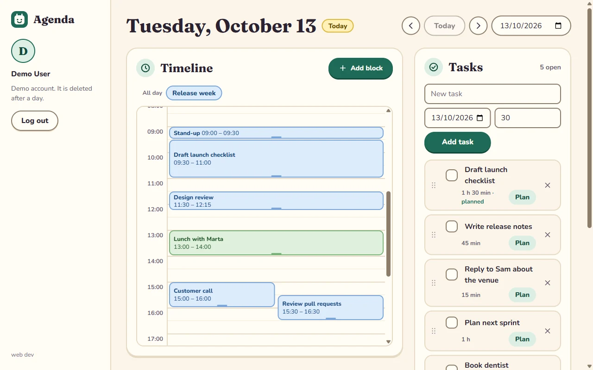
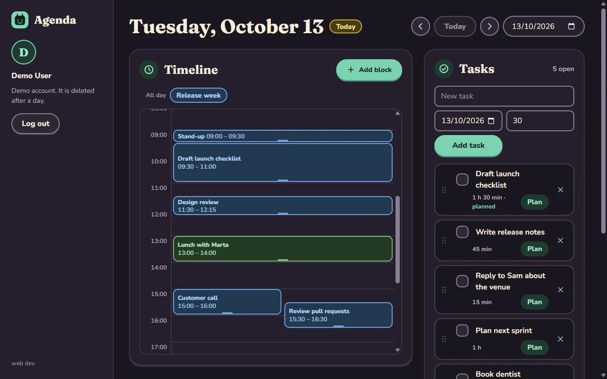
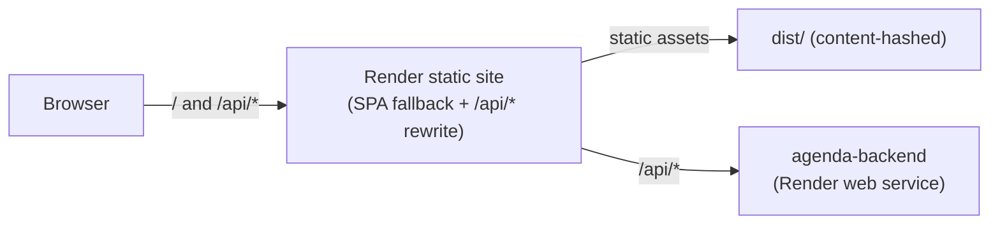
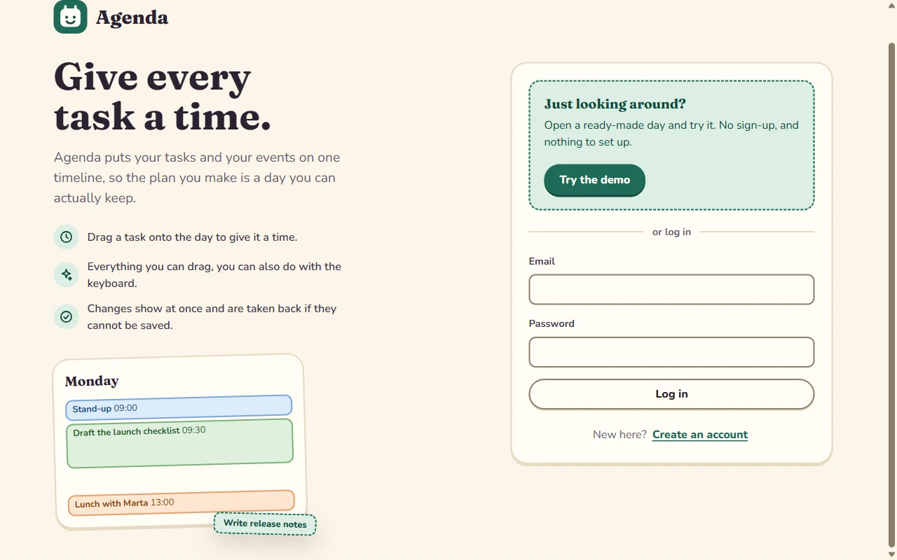

# agenda

[](https://github.com/andreagil5647/agenda/actions/workflows/ci.yml)

Web app for **Agenda**, a calendar and task planner built around time-blocking: tasks and
events live on the same timeline, and you plan a day by dragging tasks into time slots.

The API lives in [andreagil5647/agenda-backend](https://github.com/andreagil5647/agenda-backend).

> **Status:** the day planner works, in English and Spanish. Sign up or start a one-click
> demo, then plan a day on an hour grid: drag a task onto it to give it time, drag a block to
> move it, pull its edge to resize it, or do all three from the keyboard. Changes show at once
> and are taken back if the API refuses them. Themes, a week view and end-to-end tests come
> next - see the [roadmap](docs/ROADMAP.md).

<p align="center">
  
  
</p>

## Stack

| Concern    | Choice                                                      |
| ---------- | ----------------------------------------------------------- |
| Runtime    | React 19, TypeScript 6 (strict)                             |
| Build      | Webpack 5, hand-written dev/prod config, SWC (`swc-loader`) |
| Data       | TanStack Query, API client typed by the OpenAPI contract    |
| Drag       | dnd-kit for pick-up and drop, pointer events for resizing   |
| Styles     | CSS Modules on design tokens, light and dark themes         |
| Type       | Nunito and Fraunces, self-hosted variable fonts             |
| Languages  | English and Spanish, a typed in-repo message catalogue      |
| Validation | zod 4, for build-time `PUBLIC_` environment variables       |
| Tests      | Jest 30 (`@swc/jest`), React Testing Library, MSW           |
| Hosting    | Render static site, rewriting `/api/*` to the backend       |

## Architecture



The browser only ever talks to one origin. In development, `webpack-dev-server` proxies
`/api/*` to a local backend the same way; in production, the static site's rewrite does it
(see [ADR 0003](docs/adr/0003-same-origin-api-through-render-rewrite.md)). This is what
lets a session cookie set by the API stay first-party.

```text
config/webpack/     hand-written webpack config: common, dev, prod, paths, env
scripts/            sync-api-contract.js: copies the contract from the backend repo
src/
  index.tsx            bootstraps React
  app/                 providers, the server and auth gates, the signed-in shell and page
  features/<name>/     api (requests), hooks (state) and components for one feature:
                        auth, calendars, tasks, timeline
  styles/              design tokens, a test for their contrast, and the global base layer
  ui/                  shared pieces: Panel, EmptyState, Icon, Logo, query states, notices,
                        the dock in the corner, control styles
  lib/api/             API client typed by the contract, one error type, user-facing messages
  lib/i18n/            the language runtime, language detection, and the typed message
                        catalogues (messages/en.ts is the source, messages/es.ts follows it)
  lib/preferences/     what the device remembers between visits (today, the language)
  lib/time/            time zone conversion and time formatting in the language of the screen,
                        pure and unit-tested
  lib/query/           query client and the optimistic write used by every feature
  lib/env.ts           typed access to PUBLIC_ build-time variables
  lib/serverStatus/    polls the API's liveness endpoint with backoff,
                        exposes a "waking up the server" state for free-tier cold starts
  types/               declarations for CSS Modules and CSS custom properties
openapi/             the API contract, copied from the backend and committed
docs/images/         the screenshots in this file
test/msw/            in-memory API that answers the app's requests during tests
test/helpers/        the colour contrast check the token test uses
test/setup/          Jest environment and setup
```

## Design

The look is a paper planner: warm cream paper, plum-black ink, a pine green for what you press,
and pastel inks for calendars, with a soft serif for the day and a rounded sans-serif for the
interface ([ADR 0009](docs/adr/0009-visual-identity.md)).

<p align="center">
  
</p>

- Every colour, size and shadow is a custom property in `src/styles/tokens.css`. Components use
  them and never name a value, so changing the look is a change to that file.
- Light and dark come from the same tokens, with each colour written once as
  `light-dark(light, dark)`. The theme follows the system.
- The fonts are bundled and served from the same origin, so a visit makes no request to a font
  service.
- `src/styles/tokens.test.ts` fails if a text colour falls below 4.5:1 against its background, or
  a control border, focus ring or the current-time line below 3:1, in either theme.

## Languages

The app is in English and Spanish. A first visit follows the browser's language; the switch in
the bottom-left corner of every screen changes it at once, and the choice is remembered on the
device ([ADR 0010](docs/adr/0010-typed-message-catalogue.md)). It changes the text, the dates
and times (through `Intl`, in the regional form the browser asks for), plurals, the messages
for failed requests, and what screen readers hear. What a person typed, such as a task title,
stays as typed. Spanish is a separate chunk that only loads when it is wanted.

- Messages live in `src/lib/i18n/messages/`. `en.ts` is the source and `es.ts` is typed against
  it, so a missing, extra or mistyped key, or a message with different placeholders, fails the
  type check. A test fails if a Spanish message was left in English.
- ESLint rejects text typed straight into markup and into `aria-label`, `placeholder`, `title`
  and `alt` in `src/**/*.tsx`, so a screen cannot gain a string that is not translated.
- The API's own sentences are English and are never shown. A failed request is explained from its
  `code` and `details.reason`, both listed in the contract, so the explanation follows the
  language even while it is on screen.
- Signing up and the demo send the language, so a new account and its demo day start in it.

To add a language: add its code to `LANGUAGES` and its name to `LANGUAGE_NAMES` in
`src/lib/i18n/languages.ts`, write `messages/<code>.ts` typed against the English one, and add it
to `loadCatalogue`. On the backend add it to `LOCALES` and give the demo day its words. The
compiler lists everything that is still missing.

## Accessibility

- Every pointer interaction has a keyboard path. A task has a **Plan** button, which places it at
  the next free time. A focused block moves with the arrow keys, changes length with
  Shift and the arrow keys, and is removed with Delete. What changed is announced in a live
  region.
- A skip link, labelled regions, and one visible focus style for everything reachable by keyboard.
- Touch screens get 44 to 48 pixel targets and a taller hour on the grid, so a half-hour block can
  be hit. Motion is short and stops entirely with `prefers-reduced-motion`.
- Checked against the browser's accessibility tree and with the keyboard. Automated axe checks and
  a screen reader pass are still to do ([roadmap](docs/ROADMAP.md)).

## Testing

- Pure logic (time zone conversion, the grid layout, list edits, contrast) has unit tests with no
  DOM.
- Behaviour is tested through the UI with React Testing Library. The network is faked at the
  request level by MSW: `test/msw/fakeApi.ts` is an in-memory API that enforces sessions, the CSRF
  header and `If-Match`, so a test can also change something "from another tab" and watch the app
  take its own change back.
- The language switch is tested end to end through the UI: the browser's language, the choice and
  its persistence, errors that change language while on screen, and the planner in Spanish.
- A coverage floor in `jest.config.js` fails the run if coverage drops, and
  `pnpm run api:check` fails if the generated API types no longer match the contract.
- Pointer dragging is not covered by automated tests, because jsdom lays nothing out. It is
  checked by hand in a browser, and is the first thing end-to-end tests should cover.

## Getting started

Requirements: Node.js 22.13 or later. For the `/api/*` proxy to do anything locally, run
the [backend](https://github.com/andreagil5647/agenda-backend) on port 4000 first.

```bash
pnpm install --frozen-lockfile
cp .env.example .env
pnpm run dev       # http://localhost:3000, proxies /api to http://localhost:4000
```

## Scripts

| Script                                 | What it does                                      |
| -------------------------------------- | ------------------------------------------------- |
| `pnpm run dev`                         | Webpack dev server with HMR and the `/api` proxy  |
| `pnpm run build`                       | Production build to `dist/`                       |
| `pnpm run analyze`                     | Production build plus a bundle-size report        |
| `pnpm test` / `pnpm run test:coverage` | Jest / Jest with a coverage report in `coverage/` |
| `pnpm run lint` / `pnpm run format`    | ESLint (type-aware) / Prettier                    |
| `pnpm run typecheck`                   | `tsc --noEmit`                                    |
| `pnpm run api:sync`                    | Copy the API contract from the backend repo       |
| `pnpm run api:generate` / `api:check`  | Generate the API types / fail if they are stale   |

## Deployment

`render.yaml` describes the service: a free static site, deployed from `main` after CI
passes, that rewrites `/api/*` to the backend before falling back to `index.html` for
client-side routing.

| Variable             | Required | Default | Notes                            |
| -------------------- | -------- | ------- | -------------------------------- |
| `PUBLIC_APP_VERSION` |          | `dev`   | Shown at the foot of the sidebar |

`PUBLIC_` variables are read at **build** time (baked into the bundle), not at runtime;
changing one on Render requires a redeploy.

## Conventions

- Branches: `main` (deployed) ← `develop` (integration) ← `feat/*`, `fix/*`, `refactor/*`,
  `test/*`, `chore/*`, `docs/*`. See [CONTRIBUTING.md](CONTRIBUTING.md).
- Commits follow [Conventional Commits](https://www.conventionalcommits.org/), enforced by
  commitlint in a Git hook and in CI.

## Documentation

- [Roadmap](docs/ROADMAP.md): what is built, known gaps and the build order.
- [Architecture decision records](docs/adr/README.md)
- [Debugging notes](docs/debugging/README.md): bugs found during development, with the
  investigation and the regression test that now guards each one.

## License

[MIT](LICENSE)
